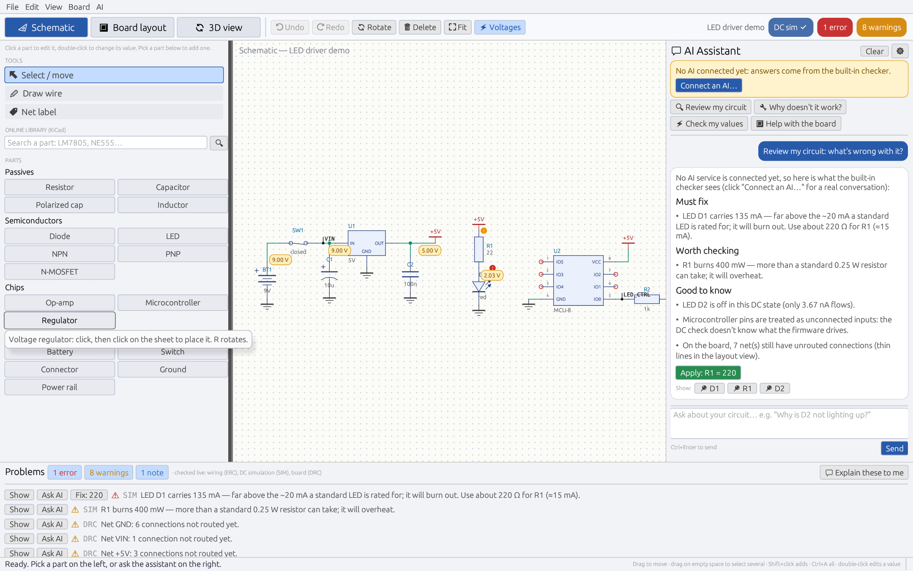
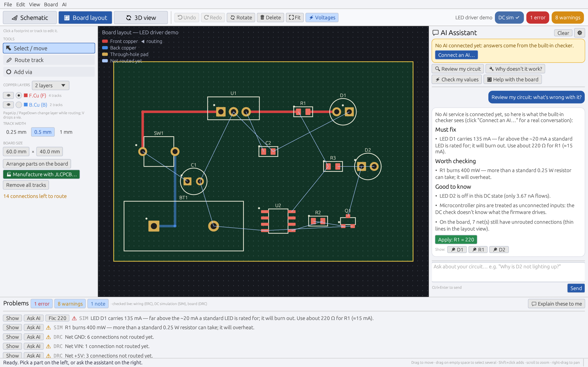
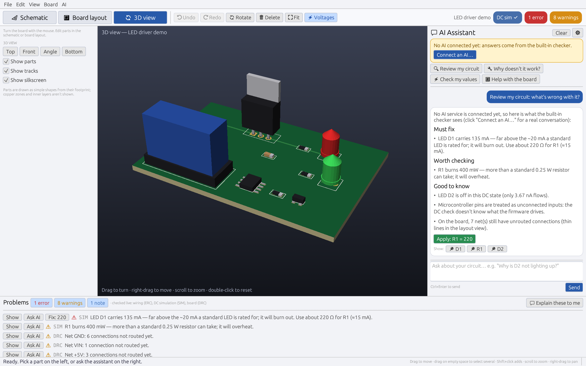
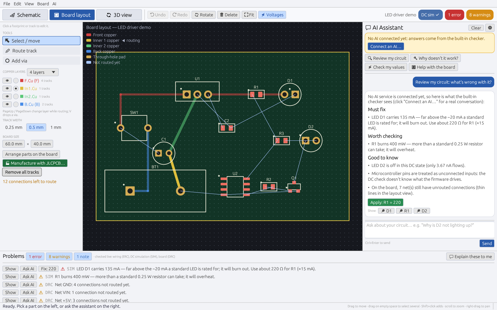
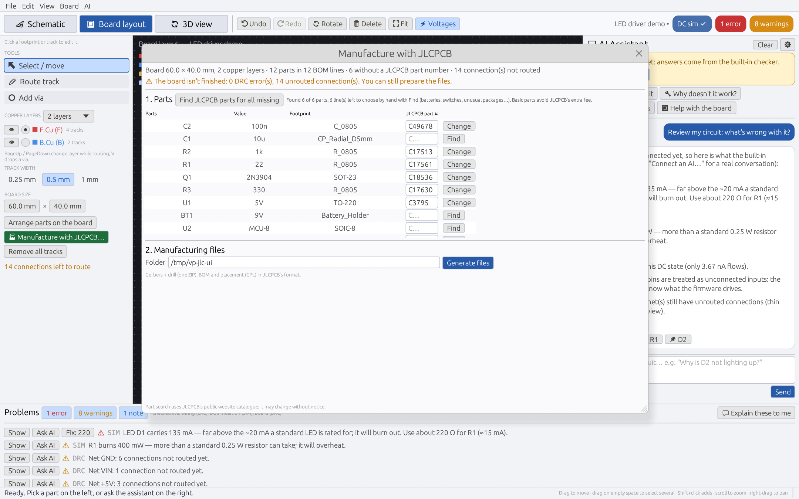
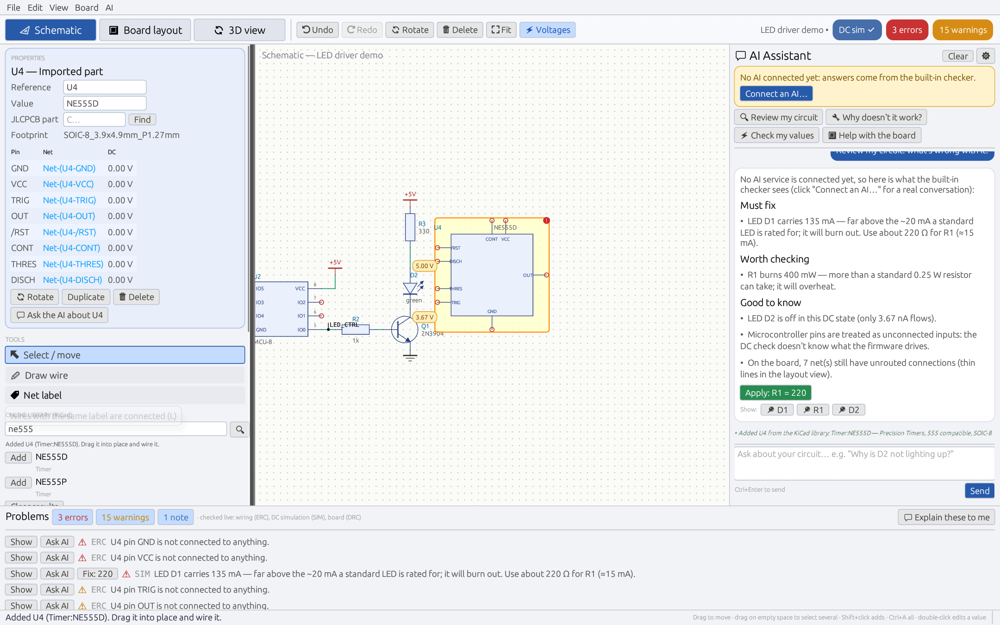

# FerrisCad

**An electronics design tool — schematic, PCB layout and 3D view — written in Rust, with a built-in AI assistant that helps you debug your circuit.**

FerrisCad checks your circuit while you draw it (wiring rules, board rules and a DC simulation), explains problems in plain language, and lets an AI propose fixes you apply with one click. It opens KiCad projects, finds parts in the official KiCad libraries and the JLCPCB catalogue, and prepares the files to order your board.



> Status: early version. It works on real projects, but expect rough edges. Feedback and issues are welcome.

---

## Features

### Design
- **Schematic editor**: built-in parts (resistors, capacitors, diodes, LEDs, transistors, MOSFETs, op-amps, regulators, microcontroller, battery, switch, connectors, power symbols), wires, net labels, rotate, duplicate, undo/redo.
- **Board layout**: footprints, 45° track routing, vias, ratsnest, board outline, **2 to 16 copper layers** with per-layer visibility.
- **3D view**: board, pads, tracks, silkscreen and simple 3D bodies for every part; orbit, zoom and pan with the mouse.
- **Multiple selection**: box selection, Shift/Ctrl+click and Ctrl+A. Moving a group keeps wires and tracks connected.

### Checks while you work
- **ERC**: unconnected pins, unpowered supply pins, shorted supplies, outputs fighting, LEDs without a resistor, missing decoupling capacitors, and more.
- **DRC**: copper connectivity (including filled zones), shorts, unrouted connections, clearance (read from your KiCad project), parts outside the board.
- **DC simulation**: voltage on every net, plus current and power in every part (resistors, diodes, LEDs, BJTs, MOSFETs, op-amps, regulators). It catches burnt LEDs, overheating resistors and regulators in dropout, and suggests a fix.

### AI assistant
- Uses **Claude Code** if it's installed on your computer (no API key needed), or a **Claude API key**, **Ollama** / any OpenAI-compatible model, or just the built-in checker.
- Sees your whole circuit: parts, nets, check results, simulated voltages, part and board positions.
- **Proposes changes as one-click buttons**: change a value, add a part (including exact parts from the KiCad library), connect pins, move, place, route, change the layer count. Everything can be undone.
- Optional, opt-in: **read-only access to folders you choose** (datasheets, your project) and **web search** for datasheets and part references.

### Parts and manufacturing
- **KiCad import** (KiCad 6 to 9): hierarchical sheets, symbols, wires and labels, footprints, tracks, vias, zones, inner layers, board outline, LCSC/JLCPCB part numbers.
- **Online KiCad library**: search the official KiCad symbol libraries and add a part with its real symbol and footprint (cached locally).
- **JLCPCB**: search their parts catalogue (stock, price, Basic/Extended), fill part numbers automatically, and generate **Gerbers + drill (ZIP), BOM and placement (CPL)** in their format, then open their order page.

---

## Screenshots

| Board layout | 3D view |
|---|---|
|  |  |
| **Multi-layer boards** | **JLCPCB manufacturing** |
|  |  |
| **Online KiCad library** | |
|  | |

---

## Install

### Linux (AppImage)
Download `FerrisCad-x86_64.AppImage` from the releases page, then:

```sh
chmod +x FerrisCad-x86_64.AppImage
./FerrisCad-x86_64.AppImage                         # opens the example circuit
./FerrisCad-x86_64.AppImage ~/my-board/board.kicad_pro   # opens a KiCad project
```

Needs Linux x86_64 with glibc 2.34 or newer (Ubuntu 22.04+, Debian 12+, Fedora 35+). OpenGL, Wayland/X11 and fonts come from your system.

### Build from source

You need [Rust](https://rustup.rs) (stable).

```sh
cargo build --release                 # program: target/release/ferriscad
./target/release/ferriscad
sh packaging/build-appimage.sh        # AppImage: dist/FerrisCad-x86_64.AppImage
```

The AppImage script downloads `appimagetool` the first time it runs.

### Connect an AI
On first start, FerrisCad uses **Claude Code** automatically if it is installed and signed in, otherwise a local **Ollama** model if one is running. Otherwise, click **Connect an AI…** in the assistant panel to choose a provider or paste an API key. When you ask a question, a text description of your circuit is sent to the AI you chose.

---

## Using FerrisCad

| Action | How |
|---|---|
| Place a part | Pick it in the left panel, click on the sheet (R rotates) |
| Draw a wire | W, click to start and bend, click a pin to finish |
| Edit a value | Double-click the part |
| Select several items | Drag on empty space · Shift/Ctrl+click · Ctrl+A |
| Route a track | X, click a pad, click to bend, click the target pad |
| Change layer while routing | PageUp / PageDown (drops a via) · V |
| Zoom / pan | Mouse wheel · right- or middle-drag |
| Undo / redo | Ctrl+Z / Ctrl+Y |
| Open / save | Ctrl+O / Ctrl+S (projects are `.fcad` files; KiCad projects open directly) |

---

## Documentation

- **[Architecture](docs/ARCHITECTURE.md)** (in French): modules, data model, connectivity, checks, simulator, AI integration, KiCad import, online library, JLCPCB export, 3D view, build and packaging.

## Project layout

```
src/
  main.rs       entry point, command-line options
  app.rs        window, panels, menus, AI chat, undo/redo
  model.rs      parts library, components, wires, tracks, layers, netlist
  sch.rs        schematic editor        pcb.rs      board editor
  view3d.rs     3D view                 multisel.rs multiple selection
  checks.rs     ERC / DRC / copper connectivity
  sim.rs        DC operating-point simulator
  ai.rs         AI providers, circuit report, change actions
  aiedit.rs     applying the AI's changes
  kicad.rs      KiCad import             online.rs   online KiCad library
  jlc.rs        JLCPCB catalogue and manufacturing files
  jlcui.rs      JLCPCB window            filedlg.rs  file dialogs
docs/           documentation and screenshots
packaging/      AppImage files and build script
```

## Known limitations
- 3D parts are simple shapes, not manufacturer 3D models; copper zones aren't drawn in 3D.
- Changes are saved in FerrisCad's own format; they aren't written back into KiCad files.
- Reference designators aren't printed on the silkscreen yet (only part outlines).
- The JLCPCB part search uses their public website catalogue, which may change without notice. JLCPCB doesn't allow other apps to place orders, so you upload the generated files on their site.
- The DC simulation doesn't know what your microcontroller firmware does, and doesn't simulate over time (no transient analysis yet).

## Credits
- Built with [egui / eframe](https://github.com/emilk/egui).
- Parts downloaded from the [official KiCad libraries](https://gitlab.com/kicad/libraries) are under CC-BY-SA 4.0 with an exception for use in your designs.
- FerrisCad is an independent project, not affiliated with KiCad or JLCPCB.

## License
To be decided by the author. Add a `LICENSE` file before publishing.
