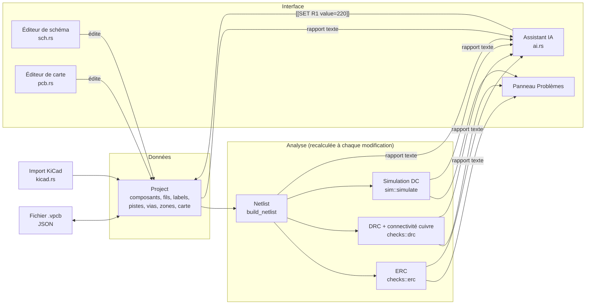
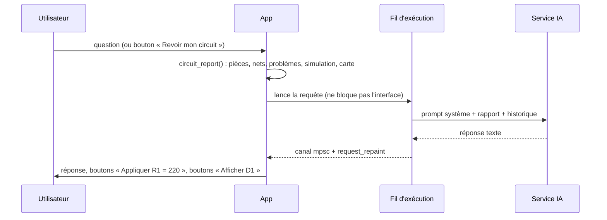

# FerrisCad — Architecture

FerrisCad est un éditeur de circuits électroniques (schéma + circuit imprimé) avec un
assistant IA intégré pour aider à déboguer le montage. C'est une application de bureau
écrite en **Rust** avec **eframe/egui** (interface en mode immédiat, rendu OpenGL).

---

## 1. Vue d'ensemble



Le principe : **une seule source de vérité**, la structure `Project`. Toute modification
(placement, fil, valeur…) passe par elle ; un drapeau `analysis_dirty` déclenche ensuite
le recalcul complet de la netlist, des vérifications et de la simulation au début de
l'image suivante. Les circuits visés (quelques centaines de composants) se recalculent en
quelques millisecondes, ce qui évite toute logique de mise à jour incrémentale.

---

## 2. Organisation des fichiers

| Fichier | Rôle |
|---|---|
| `src/main.rs` | Point d'entrée : options de ligne de commande, création de la fenêtre, petites fonctions de compatibilité glibc pour l'AppImage. |
| `src/app.rs` | État de l'application (`App`), panneaux (menus, barre d'outils, propriétés, problèmes, assistant IA, fenêtres), annuler/rétablir, fichiers, raccourcis clavier, capture d'écran. |
| `src/model.rs` | Modèle de données : bibliothèque de composants, `Component`, `Wire`, `Label`, `Track`, `Via`, `Zone`, `Board`, `Project`, construction de la netlist, lecture des valeurs (`4k7`, `100n`…), projet d'exemple. |
| `src/sch.rs` | Canevas du schéma : dessin des symboles, fils, jonctions, étiquettes de tension ; outils sélection / fil / label / placement. |
| `src/pcb.rs` | Canevas de la carte : empreintes, pastilles, pistes, vias, zones, chevelu (ratsnest), routage à 45°. |
| `src/checks.rs` | ERC (règles électriques), DRC (règles de carte), connectivité cuivre, géométrie (distances segment/rectangle…). |
| `src/sim.rs` | Simulateur DC (point de fonctionnement) par analyse nodale modifiée + Newton-Raphson. |
| `src/ai.rs` | Assistant IA : réglages, détection (Claude Code, Ollama), appel des services, rapport texte du circuit, réponse hors-ligne, lecture des actions `[[…]]`. |
| `src/aiedit.rs` | Exécution des modifications proposées par l’IA (ajouter, relier, placer, router…). |
| `src/multisel.rs` | Sélection multiple : Maj/Ctrl+clic, cadre de sélection, Ctrl+A, déplacement et suppression en groupe (les fils et pistes attachés suivent). |
| `src/online.rs` | Bibliothèque en ligne : recherche et téléchargement des symboles et empreintes officiels KiCad. |
| `src/font.rs` | Police filaire (traits simples) des textes de carte : le texte affiché est exactement celui qui part dans les Gerbers. |
| `src/kicad.rs` | Import de projets KiCad 6 à 9 (`.kicad_pro`, `.kicad_sch`, `.kicad_pcb`) : lecteur S-expressions, feuilles hiérarchiques, zones, règles. |
| `.cargo/config.toml`, `tools/host-*.sh` | Édition de liens via le compilateur de l'hôte quand la compilation tourne dans un bac à sable Flatpak sans compilateur C. |
| `packaging/` | Fichiers de l'AppImage (`AppRun`, `.desktop`, icône) et script `build-appimage.sh`. |
| `docs/` | Cette documentation. |

---

## 3. Modèle de données (`model.rs`)

### 3.1 Composants
- `Kind` : le **type électrique** (résistance, condensateur, LED, NPN, régulateur,
  microcontrôleur, masse, alimentation…, et `Generic` pour les pièces importées sans
  équivalent). Il détermine le comportement dans l'ERC et la simulation.
- `info(kind)` → `KindInfo` : description intégrée du type (broches avec position sur le
  schéma, type électrique et pastille d'empreinte, contour du corps, nom d'empreinte).
- `Component` : une instance placée (`reference`, `value`, position et rotation sur le
  schéma **et** sur la carte). Un même objet porte donc le symbole et l'empreinte : il n'y
  a pas d'étape « mettre à jour le PCB depuis le schéma ».
- `Custom` (optionnel) : géométrie propre d'une pièce **importée** (traits du symbole,
  broches, pastilles, sérigraphie). `Component::info()` fusionne `Custom` et le type de
  base ; le reste du programme ne voit qu'un `KindInfo`.

### 3.2 Unités et repères
| Vue | Unité | Grille | Remarque |
|---|---|---|---|
| Schéma | « unité schéma » entière (`i32`) | 10 unités | 10 unités = 1,27 mm KiCad (grille 50 mil), donc les points KiCad tombent exactement sur la grille. |
| Carte | millimètre (`f32`) | 0,25 mm | Coordonnées de la carte KiCad conservées telles quelles. |

L'axe Y descend (comme à l'écran). Les rotations sont des quarts de tour (`rot_i`, `rot_f`).

### 3.3 Netlist (`build_netlist`)
1. Chaque extrémité de broche, de fil et chaque label devient un point.
2. Un *union-find* relie : les deux bouts d'un fil, tout point posé **sur** un fil, les
   labels de même nom, les symboles d'alimentation de même nom (`GND`, `+5V`…).
3. Chaque groupe devient un `Net`. Nom : alimentation > label > `Net-(R1-1)`.
4. On garde aussi les points de jonction (≥ 3 connexions) pour dessiner les points.

---

## 4. Vérifications (`checks.rs`)

### 4.1 ERC (schéma)
Broches non connectées (sauf marques « non connecté »), entrée d'alimentation non
alimentée (avec propagation à travers interrupteurs, résistances, diodes), alimentations
différentes reliées, sorties qui se battent, composant court-circuité, LED sans
résistance, absence de condensateur de découplage, condensateur polarisé inversé, base de
transistor directement sur une alimentation, label isolé, références en double.

### 4.2 DRC et connectivité cuivre
- Les pastilles, pistes, vias et zones remplies sont reliés par contact géométrique
  (union-find) → **îlots de cuivre**.
- Un îlot qui touche deux nets du schéma = **court-circuit**.
- Un net réparti sur plusieurs îlots = **connexions non routées** ; le chevelu est un
  arbre couvrant minimal entre îlots.
- Isolement : écart minimal entre pistes / pastilles de nets différents (règle lue dans
  le `.kicad_pro`, 0,2 mm par défaut).
- Placement : empreinte hors du contour, empreintes qui se chevauchent.

Chaque problème est un `Issue` (gravité, source ERC/DRC/SIM, message, composants,
position, et éventuellement une **correction en un clic** `fix`).

---

## 5. Simulation DC (`sim.rs`)

Analyse nodale modifiée : une inconnue par net (la masse est la référence) et une par
source de tension. Les modèles :

| Composant | Modèle |
|---|---|
| Résistance, inductance (0,05 Ω), interrupteur fermé | conductance |
| Condensateur, connecteur | ouvert |
| Pile, alimentation non produite par le schéma | source de tension idéale |
| Diode, LED | Shockley, tension de seuil selon la couleur, limitation `pnjlim` |
| NPN / PNP | Ebers-Moll simplifié (β = 100) |
| N-MOSFET | loi quadratique (Vth = 2 V) |
| Ampli-op | gain 10⁵, saturation aux rails |
| Régulateur | source régulée / chute de tension / coupé, courant d'entrée = sortie + 5 mA |
| Microcontrôleur | 1 kΩ entre VCC et GND, broches d'E/S en haute impédance |

Itérations de Newton (convergence sur les tensions **et** sur les jonctions), puis boucle
externe pour les modes ampli-op / régulateur. Résultats : tension de chaque net, courant
et puissance de chaque pièce, et des diagnostics (LED trop alimentée avec valeur de
résistance proposée, résistance trop chaude, régulateur en décrochage, court-circuit…).

---

## 6. Assistant IA (`ai.rs`)



- **Fournisseurs** (`Provider`) :
  - `ClaudeCode` : utilise la commande `claude` déjà installée et connectée sur
    l'ordinateur (`claude -p --tools "" --system-prompt-file …`) : aucune clé, aucun
    outil activé, seule la description du circuit est envoyée.
  - `Claude` : API Anthropic avec une clé.
  - `OpenAiCompatible` : Ollama, LM Studio ou tout service compatible OpenAI.
  - `Offline` : réponse construite par le vérificateur intégré.
- Au premier lancement, `AiSettings::detect()` choisit automatiquement ce qui est
  disponible. Les réglages sont dans `~/.config/ferriscad/settings.json` (la clé n'y est
  écrite que si l'utilisateur coche « Se souvenir »).
- Le **prompt système** décrit le rôle de l'assistant, donne la position de chaque pièce
  (schéma et carte) et le contour de la carte, et lui apprend un petit langage d'actions
  qu'il écrit entre doubles crochets :

  | Action | Effet |
  |---|---|
  | `[[SET R1 value=330]]` | change une valeur (ou `ref=` pour renommer) |
  | `[[ADD resistor ref=R7 value=10k near=U2]]` | ajoute une pièce (`at=x,y` possible) |
  | `[[CONNECT R7.1 U2.IO0]]` | relie deux broches par un fil (ou par un label si le fil croiserait d'autres broches) |
  | `[[CONNECT R7.2 GND]]` | relie une broche à une alimentation ou à un net nommé |
  | `[[DELETE R7]]`, `[[MOVE R7 x,y]]`, `[[ROTATE R7]]` | retire, déplace, tourne une pièce sur le schéma |
  | `[[PLACE R7 x,y rot=90]]` | place l'empreinte sur la carte (mm) |
  | `[[ROUTE R7.1 U2.IO0 layer=F width=0.4]]` | trace une piste entre deux pastilles |
  | `[[AUTOPLACE]]` | range les empreintes dans la carte |
  | `[[ADD kicad=Timer:NE555P ref=U3 near=U2]]` | ajoute une pièce exacte de la bibliothèque KiCad en ligne |

  Une action n'est prise en compte que si elle est seule sur sa ligne (une mention dans
  une phrase reste du texte). Les broches se désignent par nom (`U3.VCC`, `/RST` ou `RST`)
  ou par numéro (`U3.8`).
- **Accès web** (option, Claude Code seulement) : outils `WebSearch` et `WebFetch` pour
  consulter des datasheets et trouver les noms exacts des pièces KiCad.

  `parse_actions` extrait ces lignes et les transforme en boutons « Apply » (un par
  action, plus « Apply all ») ; rien n'est modifié sans clic. `aiedit.rs` exécute chaque
  action ; « Apply all » forme une seule étape d'annulation (Ctrl+Z).
  `mentioned_refs` repère les références citées pour proposer de les montrer.

---

## 7. Import KiCad (`kicad.rs`)

1. **Lecture** : `parse_sx` transforme le fichier en arbre S-expression (`Sx`).
2. **Schéma** :
   - les symboles de `lib_symbols` donnent le dessin et les broches ; chaque instance est
     transformée (Y inversé, rotation, miroir) puis convertie en unités schéma ;
   - les unités d'une même référence (ex. U1A, U1B) deviennent **un** composant ;
   - `map_kind` reconnaît les pièces courantes (`Device:R`, `C`, `LED`, `Q_NPN`,
     régulateurs, ampli-op…) pour que l'ERC et la simulation les comprennent, et remet
     leurs broches dans l'ordre attendu ; les autres deviennent `Generic` ;
   - **feuilles hiérarchiques** : chaque sous-feuille est chargée récursivement et placée à
     droite de ce qui est déjà chargé, dans un cadre titré. Ses labels locaux et
     hiérarchiques sont préfixés par le chemin de la feuille (`Alim/IN+`), et les broches
     de la feuille dans le parent reçoivent le même nom : la connexion se fait par nom ;
   - fils, labels, labels globaux, marques « non connecté ».
3. **Carte** : empreintes (pastilles avec rotation, couche, sérigraphie), pistes (les arcs
   deviennent des segments), vias, contour `Edge.Cuts`, **zones remplies**
   (`filled_polygon`). Les pastilles sont reliées aux composants par référence + numéro de
   pastille. Les couches internes sont ramenées sur la couche arrière.
4. **Projet** : règle d'isolement de la classe de nets « Default » du `.kicad_pro`.

Limites actuelles : fichiers KiCad 5 non pris en charge, bus ignorés, les modifications
ne sont pas réécrites dans les fichiers KiCad (l'enregistrement produit un `.vpcb`).

---

## 7 bis. Bibliothèque en ligne (`online.rs`)

Les bibliothèques officielles KiCad (gitlab.com/kicad/libraries, licence CC-BY-SA 4.0 avec
exception pour les conceptions) sont interrogées directement :

- `kicad-symbols/<Lib>.kicad_symdir/<Symbole>.kicad_sym` : un fichier par symbole ;
- `kicad-footprints/<Lib>.pretty/<Empreinte>.kicad_mod`.

1. **Liste des bibliothèques** et **contenu d'une bibliothèque** via l'API GitLab
   (`repository/tree`, paginée), mis en cache une semaine.
2. **Recherche** (`search`) : la requête choisit les bibliothèques probables (nom de la
   bibliothèque + table d'indices : `78` → `Regulator_Linear`, `stm32` → `MCU_ST_STM32…`,
   `555` → `Timer`…), puis compare les noms de symboles. `Bibliothèque:Nom` et un nom de
   bibliothèque seul fonctionnent aussi.
3. **Téléchargement** (`fetch_part`) : le symbole (et son parent `extends`) est converti avec
   les mêmes fonctions que l'import KiCad (`symbol_items`) ; les unités multiples sont
   posées côte à côte. L'empreinte vient de la propriété `Footprint`, ou, si elle est vide,
   des motifs `ki_fp_filters` (ex. `TO?220*`) cherchés dans la bibliothèque d'empreintes.
   Les pièces simples reconnues (R, C, LED…) gardent l'empreinte standard de FerrisCad.
4. Tout est mis en cache dans `~/.cache/ferriscad/kicad-lib` : une pièce n'est téléchargée
   qu'une fois.

Dans l'interface : champ « ONLINE LIBRARY (KiCad) » au-dessus de la liste des pièces ;
« Add » télécharge la pièce, la place dans un espace libre et centre la vue dessus.

---

## 7 ter. Fabrication JLCPCB (`jlc.rs`, `jlcui.rs`)

- **Catalogue** : recherche dans le catalogue de pièces d'assemblage JLCPCB (le même service
  que leur site web ; non officiel, peut changer). Chaque pièce garde son numéro dans
  `Component::lcsc` (lu aussi depuis les propriétés `LCSC`/`JLCPCB Part #` des projets KiCad).
  Le remplissage automatique n'accepte qu'une pièce en stock **dans le même boîtier**, en
  préférant les pièces « Basic » ; batteries, interrupteurs, connecteurs et boîtiers inconnus
  restent à choisir à la main.
- **Fichiers** : Gerber RS-274X (cuivre avant/arrière avec zones, vernis, pâte, sérigraphie
  des contours, découpe), perçage Excellon (diamètres lus dans KiCad ou estimés), réunis
  dans un ZIP écrit par FerrisCad ; BOM (`Comment,Designator,Footprint,JLCPCB Part #`) et
  placement CPL (`Designator,Mid X,Mid Y,Layer,Rotation`, Y vers le haut, rotation
  anti-horaire).
- **Commande** : JLCPCB n'offre pas d'API publique pour créer une commande ; FerrisCad ouvre
  leur page de devis, où l'on dépose le ZIP puis la BOM et le CPL.

---

## 7 quater. Couches de cuivre

- `Layer` : `Front`, `Back` ou `Inner(n)` (In1.Cu = juste sous la face avant) ;
  `Board::layers` = nombre de couches (2, 4, 6… jusqu'à 16), `copper_layers()` les donne
  de l'avant vers l'arrière.
- Les pastilles traversantes et les vias touchent toutes les couches ; les pastilles CMS
  seulement la face avant ou arrière. Les zones remplies peuvent être sur n'importe quelle
  couche.
- Vue carte : choix du nombre de couches, couche de routage, affichage/masquage par
  couche ; PageUp/PageDown changent de couche pendant le routage (un via est posé).
- Import KiCad : la table `(layers …)` donne le nombre de couches, les pistes et zones
  `In1.Cu`… restent sur leur couche. Export JLCPCB : un Gerber par couche
  (`-In1_Cu.g2`, `-In2_Cu.g3`… comme KiCad).
- Une piste sur une couche que la carte n'a plus est signalée par le DRC.

## 7 quinquies. Vue 3D (`view3d.rs`)

Rendu logiciel, sans moteur 3D : la scène est une liste de triangles (position, normale,
couleur) dessinés comme un maillage egui.

1. **Scène** reconstruite à chaque image (quelques milliers de triangles) : plaque de
   1,6 mm (vernis vert, tranche FR4), pistes sous vernis, pastilles dorées, trous, vias,
   contours de sérigraphie, puis un **corps simple par pièce** déduit de son type et de son
   empreinte (CMS à deux pastilles avec embouts métalliques, boîtiers à pattes, TO-220 debout
   avec languette, LED et condensateurs chimiques cylindriques, pile, bouton, barrette…).
2. **Caméra** orbitale (`Cam3D` : lacet, inclinaison, zoom, décalage) et perspective.
3. **Affichage** : élimination des faces arrière, éclairage plat (lambertien), puis
   algorithme du peintre en trois passes — plaque, détails imprimés (ordre conservé),
   corps triés du plus loin au plus proche ; vue de dessous : les corps du dessus sont
   masqués par la plaque.

Limites : pas de modèles STEP/VRML, zones de cuivre et couches internes non affichées.

---

## 7 sexies. Rechargement du fichier (`reload.rs`)

Le fichier d'origine (projet `.fcad` ou projet KiCad) est surveillé toutes les secondes :
pour KiCad, la date la plus récente des fichiers `.kicad_sch`, `.kicad_pcb` et `.kicad_pro`
du dossier (hors sauvegardes automatiques). S'il change sur le disque (par exemple modifié
par Claude) et qu'aucune modification n'a été faite dans FerrisCad depuis le chargement, le
projet est rechargé automatiquement ; sinon un bandeau propose « Reload from disk » ou
« Keep my version ». Fichier › Reload from disk, Ctrl+R ou F5 rechargent à la demande.
Chaque rechargement est une étape d'annulation (Ctrl+Z revient à la version précédente).

---

## 7 septies. Export KiCad (`kicad_export.rs`)

Fichier › Export to KiCad… écrit un projet KiCad 8 (ouvert aussi par KiCad 9) :

- **`.kicad_sch`** : une seule feuille (les sous-feuilles importées sont mises à plat),
  format de page choisi selon la taille du schéma. Chaque pièce a son propre symbole dans
  la bibliothèque intégrée du fichier, dessiné exactement comme dans FerrisCad : les
  symboles intégrés sont « enregistrés » par le code de dessin (`sch::record_builtin`,
  mode enregistrement de `Sym`), les pièces importées utilisent leur géométrie. Broches de
  longueur 0 (leurs pattes font partie du dessin), symboles d'alimentation `(power)`,
  fils, labels, jonctions, marques « non connecté », propriétés `LCSC` et
  `FerrisCad_Kind` (qui permet de retrouver le type de pièce à la réouverture).
- **`.kicad_pcb`** : table des couches (F.Cu, In1.Cu… B.Cu), nets, empreintes avec
  pastilles (CMS / traversantes, perçage), sérigraphie, pistes, vias, zones remplies,
  contour `Edge.Cuts`. La carte est décalée si elle touche le coin de la page.
- **`.kicad_pro`** : classe de nets par défaut avec la règle d'isolement.

Test d'aller-retour (`--kicad-roundtrip`) : export puis ré-import par l'importeur KiCad
de FerrisCad, comparaison de toutes les connexions, des pistes, vias, couches et textes.

---

## 7 octies. Textes sur la carte (`font.rs`)

- **Modèle** : `BoardText { text, pos, size, rot, layer }` dans `Project::texts`, avec
  `TextLayer` = sérigraphie avant, sérigraphie arrière ou une couche cuivre.
- **Police** : chaque caractère est une suite de traits sur une grille 4 × 6 (minuscules
  avec jambages jusqu'à 8), espacement proportionnel. `layout()` centre le texte,
  `board_strokes()` le tourne par quarts de tour et le retourne en miroir sur la face arrière,
  `stroke_width()` donne l'épaisseur du trait (15 % de la hauteur).
- **Usages** : dessin à l'écran (`pcb.rs`, outil T), vue 3D, Gerbers (`jlc.rs` : textes et
  repères des composants en sérigraphie), export/import KiCad (`gr_text`, avec
  `justify mirror` sur l'arrière).

---

## 8. Interface (`app.rs`, `sch.rs`, `pcb.rs`)

- egui redessine toute la fenêtre à chaque image ; l'état d'interface (outil courant,
  sélection, glisser en cours, tracé de fil / de piste) est dans `App`.
- `View { offset, zoom }` convertit monde ↔ écran ; molette = zoom autour du curseur,
  clic droit ou molette enfoncée = déplacement.
- **Annuler/rétablir** : une copie complète du `Project` est empilée avant chaque
  modification (`checkpoint`), jusqu'à 200 niveaux.
- Les actions issues de listes (problèmes, messages IA) sont collectées dans un vecteur
  `Act` puis appliquées après le dessin, pour respecter les règles d'emprunt de Rust.

---

## 9. Fichiers, compilation, distribution

- **Format projet** : `.vpcb` = `Project` sérialisé en JSON (serde). Les champs ajoutés
  au fil des versions ont des valeurs par défaut, les anciens fichiers restent lisibles.
- **Compiler / lancer** :
  ```sh
  cd app
  cargo build --release
  ./target/release/ferriscad [fichier.vpcb | projet.kicad_pro | dossier-kicad]
  ```
- **Options utiles** :
  | Option | Effet |
  |---|---|
  | `--screenshot fichier.png` | ouvre la fenêtre sans prendre le focus, dessine ~120 images, enregistre une capture et quitte |
  | `--board` | démarre sur la vue carte |
  | `--selftest` | affiche netlist, simulation et problèmes du projet d'exemple |
  | `--import-report <chemin>` | importe un projet KiCad et affiche ce qui a été compris |
  | `--kicad-selftest` | importe un petit projet KiCad intégré |
  | `--ask "question"` | pose une question à l'IA configurée sur le projet d'exemple |
- **AppImage** : `sh packaging/build-appimage.sh` → `dist/FerrisCad-x86_64.AppImage`.
  Le script compile en mode release, assemble l'AppDir (programme, `AppRun`, `.desktop`,
  icône) et appelle `appimagetool` (téléchargé une fois dans `packaging/tools/`).
  Le binaire ne demande que **glibc 2.34** ou plus récent (Ubuntu 22.04, Debian 12,
  Fedora 35…) grâce aux fonctions de compatibilité de `main.rs`. OpenGL, Wayland/X11 et
  les polices viennent du système.

---

## 10. Pistes d'évolution

- Réécrire les modifications dans les fichiers KiCad (valeurs, références, puis ajouts).
- Simulation transitoire (condensateurs, oscillateurs) et modèle de microcontrôleur
  piloté par l'utilisateur (« IO0 à 1 »).
- Plus de pièces dans la bibliothèque, éditeur de symboles et d'empreintes.
- Laisser l'IA proposer des modifications de câblage (pas seulement des valeurs).
